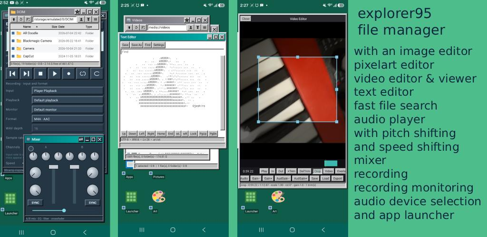
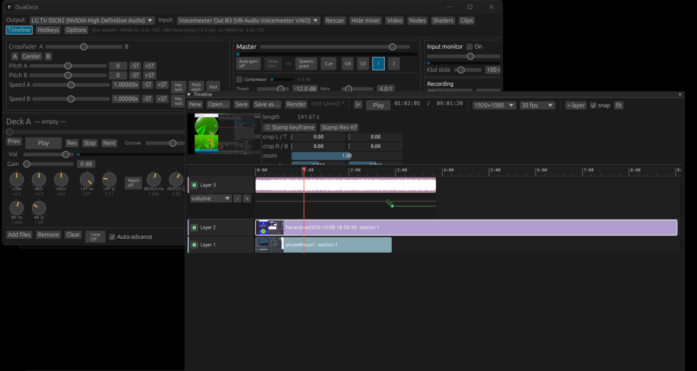
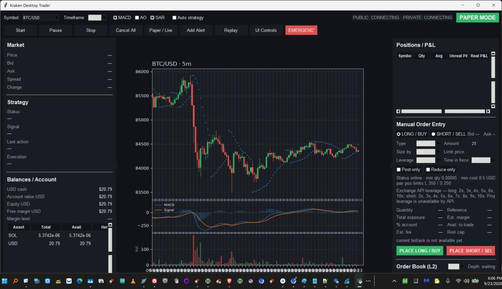
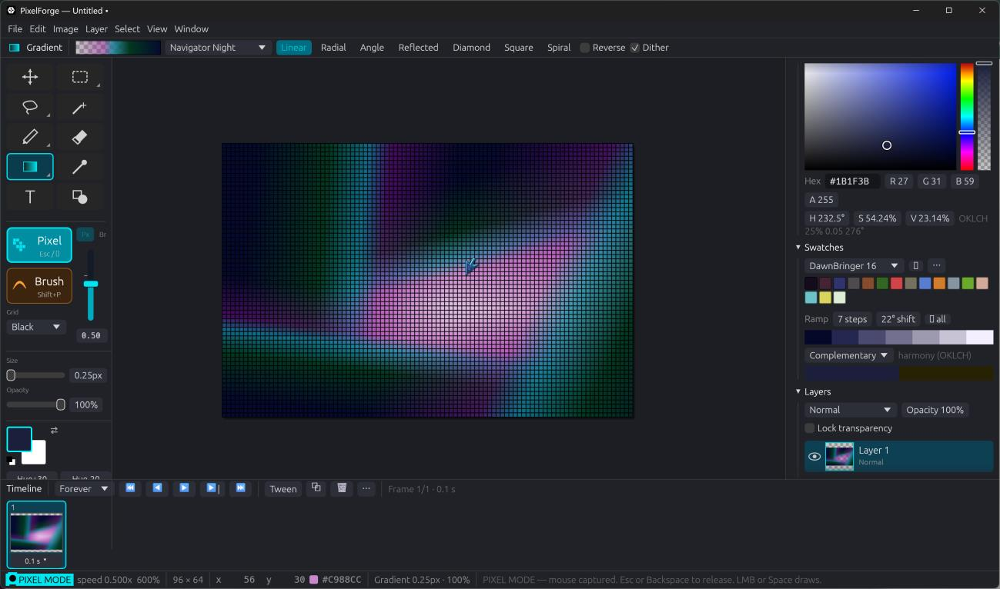
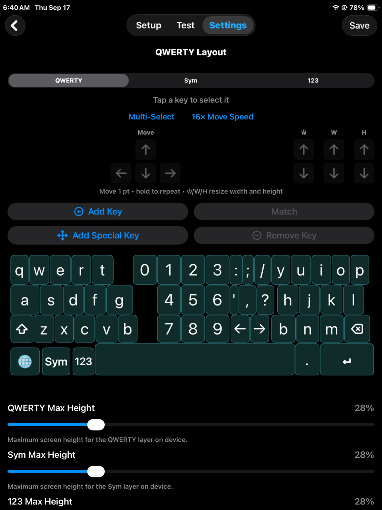
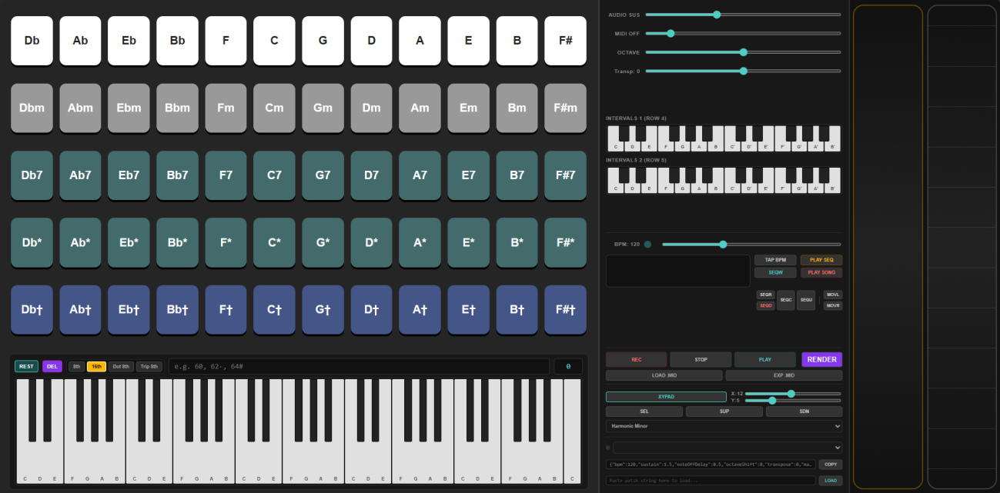

=PORTFOLIO= 
<a href="http://bunbun-midi.github.io">bunbun-midi.github.io</a> 
[Contact me](mailto:skeyboardsoftware@gmail.com) ::
Rust, Android, iOS, Python flask, SQL, batch/bash, Full-stack HTML / JS developer. 
-Developed a complete video editor w/ automation recording & crt shaders.  
-Implemented time and pitch shifting in RootlessJamesDSP fork w/ BPM targeting.  
Developed Explorer 95 (file manager for Android) (free)  
Developed Python Kraken API trading terminal.  
Developed Windows Rust File Manager w/ USN Journaling search like voidtools Everything.   
Developed PixelForge Pixel Editor (raster editor w/ photoshop-like functionality & animation editing)   
Hosting a search engine for Spotify artist names (substring match) (iframed in github link).  
Developed MIDI-OUT MPE Omnichord / Guitar Fretting Strumming Synth application (“midichord” titled “Guitar Chord Strum Midi Synth” on Play Store.  
Developed Skeyboard iOS & Android. The only actually customizable software keyboard on both mobile platforms.   
Developed binary analysis decompiler & memory editor.  
Developed large file streaming text editor.  
Developed DualDeck rust video editor (CRT shader video player w/ high rate live recording keyframe automation timeline & Audio Time/Pitchshifting DJ Mixing)  

